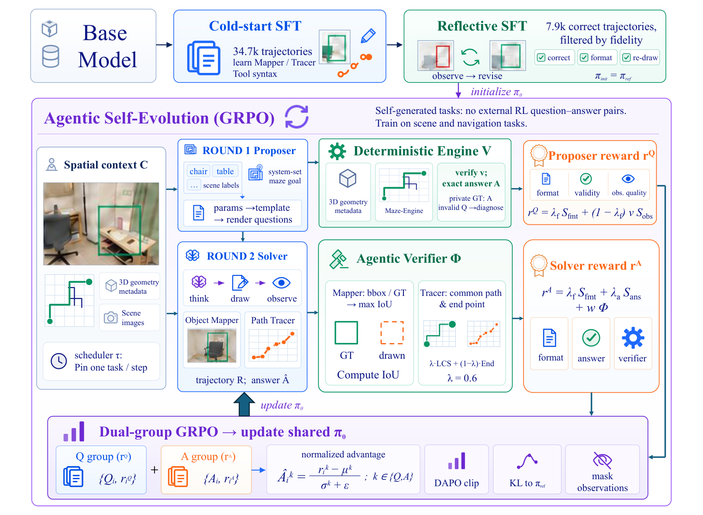
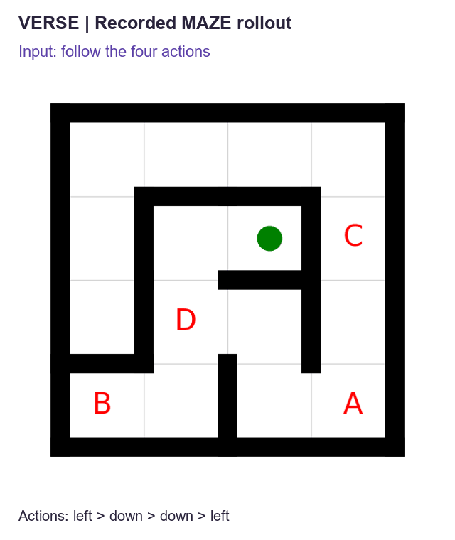

# VERSE: Verifiable Spatial Self-Evolution with Geometric Process Rewards

Xinran Liu · Yilei Jiang · Tianshuo Peng · Kaixuan Fan · Jinyuan Hu · Xiangyu Yue (corresponding author)

MMLab, The Chinese University of Hong Kong

<!-- publication:start -->
[Paper](https://aeronix-liu.github.io/VERSE/static/pdf/VERSE.pdf) · [Project page](https://aeronix-liu.github.io/VERSE/) · [Code](https://github.com/Aeronix-Liu/VERSE) · [VERSE-7B Model](https://huggingface.co/Aeronix-zzz/VERSE-7B)

arXiv and Hugging Face Paper links will be added after the arXiv ID is assigned.
<!-- publication:end -->

**VERSE** teaches a vision-language model (Qwen2.5-VL-7B) to reason about 3D space by
*drawing on images* and then **self-evolving** — the model **poses its own spatial
questions** over 3D contexts, a **deterministic engine** verifies each question and
supplies the ground-truth answer, the model **solves** them with agentic
`think → draw → observe` reasoning, and RL (GRPO) improves it — **with no external RL
annotation**. An engine-verified **process reward** can additionally reward *faithful
drawing* (boxing the right object / tracing the right path), not just lucky answers.

**Target benchmarks:** VSI-Bench, SPAR-Bench, MAZE. **Base model:** `Qwen/Qwen2.5-VL-7B-Instruct`.

## Highlights

- **Label-free RL.** Training signal comes from an engine that *computes* ground truth for
  self-generated questions (ScanNet 3D geometry / maze BFS) — the model makes its own curriculum.
- **Two drawing tools.** *Object Mapper* (draw a bounding box) and *Path Tracer* (draw a path);
  the model reasons by drawing and observing its own drawings across multiple turns.
- **Verifiable *process*, not just answers.** Because the tools draw geometric objects and the
  engine knows the true geometry, we can check the *drawing itself* (IoU vs GT box, LCS vs GT
  path) — a deterministic process reward that pure outcome RL cannot obtain.

## Method — three stages



Cold-start SFT learns tool syntax; reflective SFT learns to revise drawings;
self-evolution verifies both answers and intermediate visual actions.

| Stage | Method | Teaches | Output checkpoint |
|---|---|---|---|
| 1. Cold-start SFT | SFT on ViLaSR synthetic tool-use trajectories (~34.7k) | Object Mapper / Path Tracer *syntax* | `verse_cold_start` |
| 2. Reflective Rejection Sampling SFT | SFT on filtered self-correction trajectories (~7.9k) | think→draw→observe→**revise** | `verse_rrs` (RL init policy) |
| 3. Self-Evolve GRPO | label-free RL: propose → engine-verify → solve → update | spatial reasoning via self-generated, engine-verified problems (+ optional process reward) | `verse_self_evolve` |

Details: [`docs/project_explainer.md`](docs/project_explainer.md) (deep dive) · ablations: [`docs/ABLATIONS.md`](docs/ABLATIONS.md).

## Demo

A recorded MAZE rollout: **left → down → down → left**. VERSE traces the route
with four tool calls and answers **B**, matching the ground truth.

<p align="center">
  <a href="https://aeronix-liu.github.io/VERSE/#demo">
    
  </a>
</p>

[Explore more rollouts and the interactive verifier on the project page →](https://aeronix-liu.github.io/VERSE/#demo)

## Results

Paper results on Qwen2.5-VL-7B (VSI-Bench / SPAR-Bench / MAZE, %):

- Base model: **33.68 / 34.12 / 33.50**.
- VERSE: **40.52 / 36.01 / 90.80**.

VERSE-3B reaches **40.15 / 33.51 / 87.50**. See the paper and project page
for the complete evaluation protocol, per-task scores, and ablations.

## Release availability

This release includes the paper, project page, and training/evaluation code.
The [VERSE-7B checkpoint](https://huggingface.co/Aeronix-zzz/VERSE-7B) is available on Hugging Face. The training scripts accept local model paths.
Dataset repository names in configuration are planned endpoints; supply local data
paths until those datasets are available. ScanNet assets remain subject to the
original dataset terms.

## Repository layout

```
VERSE/
├── configs/paths.env            # single source of truth for paths/GPUs/HF namespace (edit this)
├── configs/api_keys.env.example # copy -> api_keys.env, fill your VLM key (self-evolve only)
├── requirements/                # pinned deps: selfevolve (vLLM>=0.8) + eval (vLLM 0.7.3)
├── scripts/                     # ★ supported entrypoints (setup / download / train / eval)
│   ├── setup_env.sh  download_*.sh
│   ├── train_cold_start_sft.sh  train_reflective_sft.sh  train_self_evolve.sh
│   ├── train_ablation_no_process.sh  train_ablation_no_gt.sh
│   └── eval_benchmarks.sh
├── sft/                         # LLaMA-Factory SFT configs (Stages 1–2)
├── self_evolve/                 # the self-evolve GRPO trainer (EasyR1/verl based) + DGE (src/)
│   └── ablations/               # isolated ablation reward code (+ CPU tests)
├── eval/                        # agentic + direct inference + official scorers
└── docs/                        # ATTRIBUTION.md, ABLATIONS.md
```

## Hardware & software

- **Hardware.** Released pipeline ran on **4–8× A800 (80 GB)**. SFT uses DeepSpeed ZeRO-3;
  self-evolve uses FSDP + vLLM rollout (tensor-parallel 2). ~80 GB/GPU is assumed — reduce
  `batch` / `rollout.n` / `gpu_memory_utilization` for smaller cards.
- **Software.** Linux + CUDA, conda, Python 3.10. Three conda envs (created by `scripts/setup_env.sh`):
  - `verse-sft` — LLaMA-Factory (Stages 1–2)
  - `verse` — EasyR1/verl + vLLM ≥ 0.8 (Stage 3)
  - `verse-eval` — vLLM 0.7.3 pinned (evaluation)
- **Mirrors.** Downloads default to `HF_ENDPOINT=https://hf-mirror.com` (China). Non-China users
  can `export HF_ENDPOINT=https://huggingface.co` before running.

## API keys (self-evolve stage only)

The self-evolve stage calls an OpenAI-compatible chat/VLM endpoint for the reward judges and DGE
entity extraction. Provide it once via a gitignored env file — **no keys ever live in the code**:

```bash
cp configs/api_keys.env.example configs/api_keys.env      # then fill VERSE_VLM_API_KEY (+ base_url/model)
```

SFT and evaluation need **no** API key. Leaving the key blank still runs self-evolve — the LLM-judge
reward terms simply degrade to 0 (outcome + engine-verified process rewards are unaffected).

## Quick start

```bash
# 0) configure paths (edit configs/paths.env: VERSE_ROOT/ASSETS, GPUs, HF namespace)
source configs/paths.env

# 1) environments
bash scripts/setup_env.sh all

# 2) API key for self-evolve (skip if only doing SFT/eval)
cp configs/api_keys.env.example configs/api_keys.env && ${EDITOR:-vi} configs/api_keys.env

# 3) data + base checkpoints (SFT images are the public ViLaSR release; contexts = ScanNet+maze)
bash scripts/download_data.sh
bash scripts/download_vilasr_images.sh
bash scripts/download_context.sh

# Train Stages 1 and 2 locally to reproduce the training pipeline.

# 4) train (resume from released ckpts, or run all three stages)
bash scripts/train_cold_start_sft.sh          # Stage 1
bash scripts/train_reflective_sft.sh          # Stage 2
bash scripts/train_self_evolve.sh             # Stage 3 (main run, process reward w=0.2)

# ablations (isolated; see docs/ABLATIONS.md)
bash scripts/train_ablation_no_process.sh     # outcome-only (process reward w=0)
bash scripts/train_ablation_no_gt.sh          # no GT: Round-2 by majority voting

# 5) evaluate a checkpoint on the three benchmarks (merge an FSDP self-evolve ckpt first)
bash scripts/eval_benchmarks.sh $VERSE_CKPT/verse_rrs vsi_bench spar_bench maze
```

## Data and checkpoints

Dataset preparation and local model paths are documented in the scripts.
Download the released [VERSE-7B model](https://huggingface.co/Aeronix-zzz/VERSE-7B) from Hugging Face.

## Notes

- Machine-specific paths live in `configs/paths.env`; the top-level `scripts/` are the supported,
  fully-parameterized entrypoints. Large artifacts (weights, training data, ScanNet, curves) are
  **gitignored** and fetched/produced at runtime.
- Engine-verified process rewards (`VERSE_VSI_GROUNDING_WEIGHT`,
  `VERSE_MAZE_FIDELITY_WEIGHT`) default to `0.2` in the official Stage-3
  entry; the no-process ablation forces both to `0`.
- See [`docs/ATTRIBUTION.md`](docs/ATTRIBUTION.md) for upstream credits (ViLaSR, EasyR1/verl,
  LLaMA-Factory, Qwen2.5-VL) and licenses.
